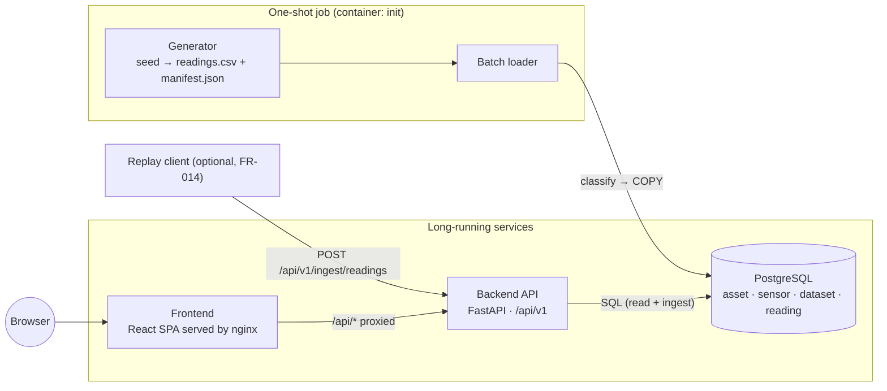

# Technical Specification — Pump Skid Telemetry Explorer

| | |
|---|---|
| Status | Draft — awaiting review |
| Phase | 1 · Specify & design |
| Implements | `docs/PRD.md` (FR-001…014, NFR-001…012) |
| Decisions | `docs/adr/` — referenced inline as ADR-NNNN |

This document says **how** the system satisfies the PRD. It is the contract that code and
tests are written against. If implementation shows something here is wrong, this document
is updated first (and the relevant ADR, if a decision changes).

Technology referenced here is chosen and justified in the ADRs:
PostgreSQL 16 (ADR-0001), long-format schema with query-time anomaly detection (ADR-0002),
batch load plus replay through one classifier (ADR-0003), FastAPI REST (ADR-0004),
React + TypeScript + ECharts (ADR-0005).

---

## 1. Architecture overview



### Data flow

1. **Generate** (FR-001). The generator produces the week of readings *in arrival order* —
   the order a real collector would receive them, including late and duplicate deliveries —
   plus a manifest of everything it injected.
2. **Classify and load** (FR-002). The loader walks the records in arrival order, assigns each
   a quality flag with the classifier (§4), and bulk-inserts all of them. Raw values are never
   altered or dropped.
3. **Query** (FR-003…013). The API derives everything else — anomalies, events, aggregates,
   gaps, completeness — from stored readings at query time with SQL (ADR-0002).
4. **Replay** (FR-014). Instead of step 2, a client posts records in arrival order to the
   ingest endpoint, which uses the same classifier. The end state is identical to a batch load.

### Backend module boundaries

| Module | Responsibility | Depends on |
|---|---|---|
| `telemetry.domain` | Sensor catalogue, quality flags, limit evaluation, the classifier. Pure Python, no I/O. | — |
| `telemetry.generator` | Signal models, fault/quality injection, writing CSV + manifest. | `domain` |
| `telemetry.ingest` | Batch loader and ingest service: reads records, classifies, writes. | `domain`, `db` |
| `telemetry.db` | Connection pool, schema migrations, SQL queries. | — |
| `telemetry.api` | FastAPI app: routing, parameter validation, serialisation, CSV streaming. | `db`, `domain` |

## 2. Domain catalogue

### 2.1 Asset and sensors

One asset: `P-101`, "Pump skid P-101".

Limits are **illustrative** values for a mid-size centrifugal pump (PRD OQ-1) and live in the
`sensor` table, not in code. Empty cells mean "no limit".

| Sensor | Measurement | Unit | Valid range | Alarm low | Warn low | Warn high | Alarm high |
|---|---|---|---|---|---|---|---|
| `TT-101` | Inlet temperature | °C | −40 … 150 | 0 | 5 | 40 | 45 |
| `TT-102` | Outlet temperature | °C | −40 … 200 | 5 | 10 | 55 | 65 |
| `PT-101` | Discharge pressure | bar | 0 … 25 | 3.0 | 4.0 | 8.5 | 10.0 |
| `VT-101` | Vibration velocity RMS | mm/s | 0 … 50 | — | — | 4.5 | 7.1 |
| `FT-101` | Flow rate | m³/h | 0 … 400 | 30 | 50 | 180 | 200 |

Vibration limits follow ISO 10816-3 zone boundaries for medium machines (4.5 mm/s: zone B/C,
7.1 mm/s: zone C/D).

### 2.2 Quality flags

Exactly one flag per stored reading. Assigned at ingest because it depends on arrival order.

| Flag | Meaning | Counts as *valid*? |
|---|---|---|
| `ok` | Normal reading | Yes |
| `late` | Valid value, but arrived after a later-timestamped reading for the same sensor | Yes |
| `outlier` | Value outside the sensor's valid range | No |
| `duplicate` | A reading for this sensor and timestamp was already received | No |

**Valid readings** (`ok` + `late`) are the only ones used for charts' lines, aggregates,
anomaly detection, completeness and "latest value".

### 2.3 Anomaly kinds

Computed at query time from valid readings (ADR-0002).

| Kind | Rule | Severity |
|---|---|---|
| `limit` | Value < alarm low or > alarm high | `alarm` |
| `limit` | Value < warn low or > warn high (and not alarm) | `warning` |
| `statistical` | \|z\| ≥ 4.0 against the rolling window (§5.3), and not a `limit` anomaly | `info` |

Each anomaly also has a **direction**: `high` or `low` (for statistical: sign of z).

## 3. Synthetic data generator (FR-001)

### 3.1 Interface

```
telemetry-generate --seed 42 --out data/generated/ [--weeks 1] [--start 2026-11-02T00:00:00Z]
```

Writes:

- `readings.csv` — one record per delivery, **in arrival order**.
- `manifest.json` — what was generated and injected (§3.5).

`--weeks N` exists for the NFR-001 load test (10 weeks ≈ 504,000 readings); the default is 1.

### 3.2 Determinism

- All randomness comes from one `numpy.random.Generator` created with `default_rng(seed)`.
  Each sensor and each injection step draws from a child generator
  (`SeedSequence(seed).spawn(...)`) in a fixed order, so adding a step later does not shift
  earlier draws.
- Values are rounded to 3 decimal places before writing, so output is byte-identical across
  machines that use the pinned dependency versions.
- `GENERATOR_VERSION` (semver string in code) is bumped whenever output for a given seed changes.
- The SHA-256 of `readings.csv` is recorded in the manifest and in the `dataset` table.

### 3.3 Output format — `readings.csv`

| Column | Type | Example | Notes |
|---|---|---|---|
| `seq` | int | `1734` | Arrival order, 1-based, unique, gap-free |
| `sensor_id` | string | `VT-101` | |
| `ts` | ISO 8601 UTC | `2026-11-04T09:15:00Z` | Measurement time, whole minutes |
| `value` | decimal | `5.812` | Up to 3 decimals |

### 3.4 Signal models

`t` = minutes since period start; `h` = hour of day (UTC); `N(σ)` = Gaussian noise.

| Sensor | Baseline model |
|---|---|
| `FT-101` | 120 m³/h from 06:00–22:00, 80 m³/h otherwise, with 15-min linear ramps between; + N(2.0) |
| `PT-101` | 2.0 + 0.033 × flow (≈ 6.0 bar at 120 m³/h); + N(0.05) |
| `TT-101` | 25 + 3·sin(2π(h − 9)/24) (ambient daily cycle, peak at 15:00); + N(0.3) |
| `TT-102` | TT-101 + 6 + 0.015 × flow (≈ 33 °C at 120 m³/h); + N(0.3) |
| `VT-101` | 2.0 mm/s; + N(0.1), floored at 0 |

#### Scripted process events

These are fixed in time so tests and demos can rely on them. They produce real anomalies
(not outliers).

| ID | When (UTC) | What happens | Expected anomalies |
|---|---|---|---|
| EV-1 | 2026-11-04 08:00–14:00 | Bearing degradation: VT-101 ramps 2.0 → 8.0 mm/s; TT-102 rises up to +12 °C. Back to baseline at 14:00 (maintenance). | VT-101 warning → alarm high; TT-102 warning (and alarm) high — one event per sensor |
| EV-2 | 2026-11-05 03:00–03:20 | Pump trip: FT-101 → 0 ± 0.5, PT-101 → 0.5 ± 0.05. | FT-101 alarm low; PT-101 alarm low |
| EV-3 | 2026-11-06 15:00 | Single pressure spike: PT-101 + 1.2 bar for one reading (≈ 7.2 bar, inside limits). | PT-101 statistical high (FR-009) |

### 3.5 Data quality injection

Applied after the signals are built, in this order. Counts are fixed; positions are drawn from
the seed (except the scripted dropouts) and never overlap scripted events.

| Issue | Injection | Effect in `readings.csv` |
|---|---|---|
| Dropout | `FT-101` offline 2026-11-07 10:00–11:30 (90 min); `TT-101` offline 2026-11-03 22:00–22:20 (20 min) | Slots omitted |
| Gaps | Per sensor: 20 single missing slots + 5 gaps of 2–10 consecutive slots | Slots omitted |
| Outliers | Per sensor: 10 readings replaced with a value outside the valid range (sentinels `-999`, `9999`, or 10× valid max) | Value out of range |
| Out-of-order | 0.5% of remaining readings delivered 1–30 min late | Record moved later in `seq` order |
| Duplicates | 0.2% of readings delivered a second time, 0–30 min later, with value ± 1% | Extra record, same `sensor_id` + `ts` |

Every sensor therefore has at least one gap; at least one dropout ≥ 15 min exists; and the
dataset contains late, duplicate and outlier deliveries — satisfying FR-001 criterion 3.

### 3.6 Manifest — `manifest.json`

```json
{
  "generator_version": "1.0.0",
  "seed": 42,
  "period_start": "2026-11-02T00:00:00Z",
  "period_end": "2026-11-09T00:00:00Z",
  "readings_sha256": "…",
  "record_count": 50190,
  "expected_flags": { "ok": 49700, "late": 245, "outlier": 50, "duplicate": 99 },
  "missing_slots": { "FT-101": 165, "TT-101": 95, "…": 0 },
  "events": [ { "id": "EV-1", "sensor_ids": ["VT-101", "TT-102"], "start": "…", "end": "…" } ]
}
```

Numbers above are illustrative. `expected_flags` and `missing_slots` are the oracle for
FR-002 and FR-011 tests: the generator knows what it injected, so tests compare the loader
and quality summary against it.

## 4. Ingestion (FR-002, FR-014)

### 4.1 Classifier

A pure function in `telemetry.domain`, shared by the batch loader and the ingest endpoint:

```
classify(record, state) -> (flag, new_state)
state per sensor: set of timestamps already received, latest timestamp received
```

Rules are evaluated **in this order**; the first match wins:

1. `(sensor_id, ts)` already received → `duplicate`
2. `value` outside the sensor's valid range → `outlier`
3. `ts` < latest timestamp received for the sensor → `late`
4. otherwise → `ok`

The record's timestamp is added to the sensor's state for every flag (so a later copy of an
outlier is still a `duplicate`). "Latest timestamp" only advances on `ok` / `late` / `outlier`.

Because the flag depends only on arrival order, batch load and replay produce identical flags
for the same input (FR-014 criterion 3).

### 4.2 Batch loader

```
telemetry-load --input data/generated/   # runs once in the init container, after telemetry-migrate
```

1. Read `manifest.json`; compute SHA-256 of `readings.csv` and check it matches.
2. If a `dataset` row with that SHA-256 exists → log "already loaded", exit 0 (idempotent).
3. If a *different* dataset is already loaded → exit non-zero with a clear message unless
   `--replace` is passed (one dataset at a time).
4. Stream records in `seq` order through the classifier; write in one transaction using
   `COPY` into `reading`, then insert the `dataset` row with counts per flag.
5. Log a structured summary: seed, version, record count, counts per flag, duration (NFR-011).

Throughput target: ≥ 1,700 readings/s (NFR-002). `COPY` of 50k rows is expected to take
well under 5 s, leaving most of the 30 s budget for generation and startup.

### 4.3 Ingest endpoint (replay)

`POST /api/v1/ingest/readings` accepts a batch of records in arrival order (§6.9). The service
rebuilds classifier state for the affected sensors from the database (existing timestamps
and latest valid timestamp), classifies, and inserts in one transaction. Batches must be
sent sequentially; concurrent replays are not supported (single-writer assumption,
documented in ADR-0003).

The replay client (`telemetry-replay --speed 60`) reads `readings.csv` and posts records
whose `ts` has "arrived" according to `speed`, in batches of up to 500.

## 5. Database

### 5.1 Schema

```sql
CREATE TABLE asset (
    id          text PRIMARY KEY,                 -- 'P-101'
    name        text NOT NULL
);

CREATE TABLE sensor (
    id          text PRIMARY KEY,                 -- 'VT-101'
    asset_id    text NOT NULL REFERENCES asset(id),
    name        text NOT NULL,
    measurement text NOT NULL,                    -- 'vibration'
    unit        text NOT NULL,                    -- 'mm/s'
    valid_min   double precision NOT NULL,
    valid_max   double precision NOT NULL,
    alarm_low   double precision,
    warn_low    double precision,
    warn_high   double precision,
    alarm_high  double precision
);

CREATE TABLE dataset (
    id                 serial PRIMARY KEY,
    readings_sha256    text NOT NULL UNIQUE,
    seed               integer NOT NULL,
    generator_version  text NOT NULL,
    period_start       timestamptz NOT NULL,
    period_end         timestamptz NOT NULL,
    loaded_at          timestamptz NOT NULL DEFAULT now(),
    load_mode          text NOT NULL CHECK (load_mode IN ('batch', 'replay')),
    flag_counts        jsonb NOT NULL              -- {"ok": n, "late": n, ...}
);

CREATE TABLE reading (
    id          bigserial PRIMARY KEY,
    dataset_id  integer NOT NULL REFERENCES dataset(id) ON DELETE CASCADE,
    seq         integer NOT NULL,                 -- arrival order from the source
    sensor_id   text NOT NULL REFERENCES sensor(id),
    ts          timestamptz NOT NULL,
    value       double precision NOT NULL,
    quality     text NOT NULL CHECK (quality IN ('ok', 'late', 'outlier', 'duplicate')),
    UNIQUE (dataset_id, seq)
);

CREATE INDEX reading_sensor_ts ON reading (sensor_id, ts);
```

- **Long format** (one row per reading) — ADR-0002.
- Asset and sensor rows are seeded by the first migration.
- `reading` has no unique `(sensor_id, ts)` because duplicates are stored, not discarded.
- Migrations are versioned SQL files applied by the one-shot `init` job before data is loaded
  (`telemetry-migrate`; tooling in ADR-0006, ordering in ADR-0008).
- For replay, a `dataset` row is created at the first batch with `load_mode = 'replay'` and its
  counts updated per batch.

### 5.2 Sizing

| Item | Estimate |
|---|---|
| Readings (1 week) | ≈ 50,200 rows (50,400 slots − missing + duplicates) |
| Row size incl. tuple overhead | ≈ 70 bytes → ≈ 3.5 MB heap |
| Indexes (PK, unique, sensor/ts) | ≈ 4 MB |
| **Total** | **≈ 8 MB**; 10× (NFR-001) ≈ 80 MB |

At this size every query below is an index range scan over at most ~10k rows per sensor and
completes in milliseconds. No partitioning, materialized aggregates or time-series extension
is needed (ADR-0001).

### 5.3 Derived data (query time)

All derivations filter `quality IN ('ok', 'late')`.

**Hourly aggregates** (FR-006) — every hour in range is returned, including empty ones:

```sql
SELECT h.hour_start,
       min(r.value), max(r.value), avg(r.value), count(r.value)
FROM generate_series(:from, :to - interval '1 hour', interval '1 hour') AS h(hour_start)
LEFT JOIN reading r
       ON r.sensor_id = :sensor_id
      AND r.quality IN ('ok', 'late')
      AND r.ts >= h.hour_start AND r.ts < h.hour_start + interval '1 hour'
GROUP BY h.hour_start
ORDER BY h.hour_start;
```

`from` and `to` must be aligned to whole hours for this endpoint (422 otherwise).

**Limit anomalies** (FR-008) — `CASE` over the sensor's limits per reading, then grouped into
**events**: consecutive breaching readings of the same sensor and direction belong to one
event while each is ≤ 5 minutes after the previous one. Event severity is the worst reached;
peak is the most extreme value. Implemented with the "gaps and islands" pattern (`lag()` +
running `sum()` to number groups).

**Statistical anomalies** (FR-009) — per reading, mean and standard deviation of the same
sensor's valid readings in the preceding 60 minutes, excluding the reading itself:

```sql
avg(value)        OVER w, stddev_samp(value) OVER w, count(*) OVER w
WINDOW w AS (PARTITION BY sensor_id ORDER BY ts
             RANGE BETWEEN interval '60 minutes' PRECEDING AND CURRENT ROW
             EXCLUDE CURRENT ROW)
```

A reading is flagged when the window has ≥ 30 readings, stddev > 0, and |z| ≥ 4.0. Readings
already flagged as `limit` anomalies are not also flagged statistical. Each statistical
anomaly is its own event. Parameters (window, minimum count, threshold) are constants in
`telemetry.domain`.

**Gaps** (FR-007) — between consecutive valid readings of a sensor, any jump > 1 minute is a gap
`[previous ts + 1 min, next ts)`. Missing slots at the start or end of the requested range also
count. A gap ≥ 15 minutes is a dropout.

**Completeness** (FR-011) — distinct valid timestamps ÷ expected slots in range.

## 6. API contract

Base path: `/api/v1`. JSON responses unless noted. An OpenAPI document is generated by the
backend at `/api/v1/openapi.json`; this section is the source of truth it must match
(contract tests in ADR-0007).

### 6.1 Conventions

- **Time parameters** `from` (inclusive) and `to` (exclusive) are ISO 8601 with an explicit
  offset (`Z` or `+00:00`). Timestamps without an offset → 422. Responses always use `Z`.
- **Defaults**: when omitted, `from`/`to` are the loaded dataset's period.
- **Range limit**: `to − from` ≤ 31 days; `from` < `to`. Violations → 422.
- **Repeated parameters** for lists: `?sensor_id=TT-101&sensor_id=TT-102`.
- **Unknown sensor ID** → 404.
- **No dataset loaded** → 503 with problem type `dataset-not-loaded`.

### 6.2 Error format

[RFC 9457](https://www.rfc-editor.org/rfc/rfc9457) problem details,
`Content-Type: application/problem+json`:

```json
{
  "type": "https://telemetry.local/problems/validation-error",
  "title": "Invalid request parameters",
  "status": 422,
  "detail": "'from' must include a UTC offset",
  "errors": [ { "param": "from", "message": "must include a UTC offset" } ]
}
```

| Status | `type` suffix | When |
|---|---|---|
| 404 | `not-found` | Unknown sensor or resource |
| 422 | `validation-error` | Bad parameters or body |
| 503 | `dataset-not-loaded` | Database reachable but empty |
| 500 | `internal-error` | Anything unexpected; details only in logs |

### 6.3 `GET /health`

```json
{ "status": "ok", "database": "ok", "dataset_loaded": true }
```

Returns 200 when the API is up, even if the database is down (`"database": "unavailable"`,
`"status": "degraded"`), so container healthchecks can distinguish the two.

### 6.4 `GET /dataset` — current dataset

```json
{
  "seed": 42, "generator_version": "1.0.0", "load_mode": "batch",
  "period_start": "2026-11-02T00:00:00Z", "period_end": "2026-11-09T00:00:00Z",
  "loaded_at": "…", "flag_counts": { "ok": 49700, "late": 245, "outlier": 50, "duplicate": 99 }
}
```

### 6.5 `GET /sensors` — overview (FR-003)

```json
[
  {
    "id": "VT-101", "name": "Vibration", "measurement": "vibration", "unit": "mm/s",
    "limits": { "alarm_low": null, "warn_low": null, "warn_high": 4.5, "alarm_high": 7.1 },
    "latest": { "ts": "2026-11-08T23:59:00Z", "value": 2.031 },
    "status": "normal",
    "completeness": 0.991
  }
]
```

`status` ∈ `normal | warning | alarm | no_data`, from the latest valid reading.
`latest` is `null` only if the sensor has no valid reading at all.

### 6.6 `GET /readings` — time series (FR-004, FR-005, FR-007)

Query: `sensor_id` (1–5, repeated), `from`, `to`, `include_invalid` (bool, default `false`).

```json
{
  "from": "2026-11-04T06:00:00Z", "to": "2026-11-04T16:00:00Z",
  "series": [
    {
      "sensor_id": "VT-101", "unit": "mm/s",
      "points": [ { "ts": "2026-11-04T06:00:00Z", "value": 2.012, "quality": "ok" } ],
      "gaps":   [ { "start": "2026-11-04T07:12:00Z", "end": "2026-11-04T07:15:00Z", "dropout": false } ]
    }
  ]
}
```

- Points sorted by `ts`. With `include_invalid=false`, only `ok` and `late` points are returned.
- No server-side downsampling: the maximum payload is 5 sensors × 10,080 points ≈ 50k points
  (≈ 3 MB JSON, ≈ 400 KB gzipped). The client downsamples for display (§7.3).

### 6.7 `GET /aggregates` — hourly aggregates (FR-006)

Query: `sensor_id` (repeated), `from`, `to` (hour-aligned), `bucket` (only `1h` supported).

```json
{
  "bucket": "1h",
  "series": [
    {
      "sensor_id": "FT-101", "unit": "m³/h",
      "rows": [ { "hour_start": "2026-11-07T10:00:00Z", "min": null, "max": null, "avg": null, "count": 0 } ]
    }
  ]
}
```

### 6.8 `GET /anomalies` — anomaly events (FR-008, FR-009, FR-010)

Query: `sensor_id` (repeated, optional), `severity` (repeated: `alarm|warning|info`),
`kind` (`limit|statistical`), `from`, `to`, `limit` (default 100, max 1000), `offset`.

```json
{
  "total": 7,
  "items": [
    {
      "id": "VT-101:2026-11-04T10:41:00Z",
      "sensor_id": "VT-101", "kind": "limit", "severity": "alarm", "direction": "high",
      "start": "2026-11-04T09:58:00Z", "end": "2026-11-04T13:59:00Z",
      "peak": { "ts": "2026-11-04T13:57:00Z", "value": 8.041 },
      "reading_count": 232
    }
  ]
}
```

Sorted by `start` descending. `id` is deterministic (`sensor_id:start`) so the UI can link to
events. `end` is the timestamp of the last breaching reading (inclusive).

### 6.9 `POST /ingest/readings` — replay ingest (FR-014)

```json
{ "seed": 42, "generator_version": "1.0.0", "period_start": "…", "period_end": "…",
  "records": [ { "seq": 1, "sensor_id": "TT-101", "ts": "…", "value": 24.81 } ] }
```

Response `200`: `{ "accepted": 500, "flag_counts": { "ok": 497, "late": 2, "outlier": 1, "duplicate": 0 } }`.
Batch size 1–500. A `seq` already stored for the dataset → that record is skipped
(idempotent retries). Dataset metadata must match the current replay dataset (422 otherwise).

### 6.10 `GET /quality` — data quality summary (FR-011)

Query: `sensor_id` (repeated, optional), `from`, `to`.

```json
[
  {
    "sensor_id": "FT-101", "expected_slots": 10080, "valid_readings": 9915,
    "completeness": 0.9836, "gap_count": 26, "dropout_count": 1,
    "longest_gap": { "start": "2026-11-07T10:00:00Z", "end": "2026-11-07T11:30:00Z", "minutes": 90 },
    "flag_counts": { "ok": 9866, "late": 49, "outlier": 10, "duplicate": 20 }
  }
]
```

### 6.11 CSV exports (FR-012, FR-013)

Streamed responses, `Content-Type: text/csv; charset=utf-8`, with
`Content-Disposition: attachment; filename="<kind>_<from>_<to>.csv"`. UTF-8, comma-separated,
`\n` line endings, header row always present (even with no data rows).

`GET /export/readings.csv` — query: `sensor_id` (repeated), `from`, `to`, `valid_only` (default `false`).

```
sensor_id,ts,value,unit,quality
VT-101,2026-11-04T06:00:00Z,2.012,mm/s,ok
```

`GET /export/aggregates.csv` — query as §6.7.

```
sensor_id,hour_start,min,max,avg,count,unit
FT-101,2026-11-07T10:00:00Z,,,,0,m³/h
```

Rows sorted by `sensor_id`, then time. Values written with the shortest representation that
round-trips the stored `double` (FR-012 criterion 2). Averages are not rounded.

## 7. Frontend

### 7.1 Views and routes

State lives in the URL so any view can be bookmarked or linked from an anomaly.

| Route | View | Requirements |
|---|---|---|
| `/` | **Overview**: card per sensor (latest value, unit, status colour, completeness) + the 5 most recent alarm/warning events | FR-003, FR-010 |
| `/sensors/:id?from&to` | **Sensor detail**: time-series chart with limit lines, gap breaks, dropout shading, anomaly markers; hourly aggregates table below | FR-004, FR-006, FR-007, FR-008 |
| `/compare?sensor_id=…&from&to` | **Compare**: stacked panels, one per unit, sharing one time axis and zoom | FR-005, FR-007 |
| `/anomalies?sensor_id&severity&kind` | **Anomalies**: filterable table; a row links to the sensor/compare view centred on the event with 1 h of context each side | FR-010 |
| `/quality` | **Data quality**: table of §6.10 per sensor + dataset info (seed, version) | FR-011 |

**Export** is a dialog available on sensor detail and compare views: raw or hourly, valid-only
toggle, uses the view's current sensors and range (FR-012, FR-013).

### 7.2 Display conventions

- All times shown in UTC and labelled "UTC" (NFR-008).
- Status colours: alarm = red, warning = amber, info = blue, normal = neutral; colour is never
  the only signal (icons + text labels too).
- Empty states: "No readings in this range" instead of blank charts or errors.
- API errors show the problem `title` and `detail` in an inline banner.

### 7.3 Charting

- ECharts line series with `connectNulls: false`. The client inserts a `null` point at each
  gap's start so lines break (FR-007); dropouts render as shaded `markArea`s.
- Limit lines as `markLine`s; anomaly events as `markArea`s (limit) or `markPoint`s (statistical).
- Downsampling for display uses ECharts' built-in `sampling: 'lttb'`, which keeps peaks visible
  at full-week zoom and shows every point when zoomed in. Server-side downsampling is
  deliberately left out at this data volume (ADR-0005).
- Compare view links zoom across panels with a shared `dataZoom` (FR-005 criterion 2).

## 8. Configuration

All configuration through environment variables; `.env.example` documents them.

| Variable | Used by | Default |
|---|---|---|
| `DATABASE_URL` | init, backend | `postgresql://telemetry:telemetry@db:5432/telemetry` |
| `GENERATOR_SEED` | init | `42` |
| `GENERATOR_START` | init | `2026-11-02T00:00:00Z` |
| `GENERATOR_WEEKS` | init | `1` |
| `LOG_LEVEL` | init, backend | `INFO` |
| `INIT_LOAD` | init | `true` (`false` = migrate only, for a replay demo) |
| `API_BASE_URL` | replay client | `http://backend:8000/api/v1` |

The local default credentials are for the local stack only; Phase 2 governance covers secrets.

## 9. Logging and health (NFR-011)

- JSON logs to stdout, one object per line, with `timestamp`, `level`, `logger`, `message` and
  context fields. The backend logs one line per request (method, path, status, duration).
- Health checks: database — `pg_isready`; backend — `GET /api/v1/health`; frontend — nginx
  serving `/`. The `init` job (migrate → generate → load) is one-shot; the backend waits for it
  to complete successfully.

## 10. Requirement traceability

| Requirement | Specified in | Primary test level (ADR-0007) |
|---|---|---|
| FR-001 | §3 | Unit (generator determinism, manifest invariants) |
| FR-002 | §4.1, §4.2, §5.1 | Unit (classifier) + integration (loader vs manifest) |
| FR-003 | §6.5, §7.1 | Integration (API) + e2e |
| FR-004 | §6.6, §7.3 | Integration (API) + e2e |
| FR-005 | §6.6, §7.1, §7.3 | Integration (API) + e2e |
| FR-006 | §5.3, §6.7 | Integration (SQL vs reference calculation) |
| FR-007 | §5.3, §6.6, §7.3 | Integration (gap computation) + frontend unit |
| FR-008 | §2.3, §5.3, §6.8 | Integration (EV-1, EV-2 detected as events) |
| FR-009 | §2.3, §5.3, §6.8 | Integration (EV-3 detected; no flag after dropout) |
| FR-010 | §6.8, §7.1 | Integration (filters, order) + e2e (drill-down) |
| FR-011 | §5.3, §6.10 | Integration (quality summary vs manifest) |
| FR-012 | §6.11 | Integration (CSV format, round-trip) |
| FR-013 | §6.11 | Integration (CSV format, empty hours) |
| FR-014 | §4.3, §6.9 | Integration (replay state equals batch state) |
| NFR-001 | §3.1, §5.2 | Performance (10-week dataset) |
| NFR-002 | §4.2 | Performance (timed load) |
| NFR-003 | §5.2, §6 | Performance (p95, report-only) |
| NFR-004 | §6.6, §7.3 | e2e timing + manual |
| NFR-005 | §5.1 | Integration (data survives restart) |
| NFR-006 | §3.2 | Unit + integration |
| NFR-007 | §8, ADR-0008 | CI smoke test on clean runner |
| NFR-008 | §6.1, §7.2 | Unit (parsing/formatting) |
| NFR-009–010 | ADR-0006, ADR-0007, ADR-0009 | CI gates |
| NFR-011 | §9 | Smoke test |
| NFR-012 | §7 | Manual |

## 11. Deliberately left out

| Not doing | Why | Revisit when |
|---|---|---|
| TimescaleDB / InfluxDB | ~8 MB of data; plain PostgreSQL queries are already in milliseconds | Data grows beyond ~100M rows or needs automatic retention |
| Materialized hourly aggregates | Computing on read is fast and never stale | Aggregate queries exceed NFR-003 |
| Storing anomaly flags | Limits may change; query-time results are always consistent | Detection becomes expensive (e.g. ML models) |
| Server-side downsampling (LTTB in the API) | Max payload ≈ 50k points; client-side LTTB is enough | Ranges or sensor counts grow 10×+ |
| WebSockets / server-sent events | Replay (Could) polls `GET /readings` every 5 s | Real-time becomes a Must |
| Concurrent writers | One loader or one replay at a time | Real device ingestion |
