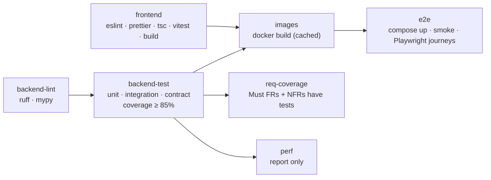

# ADR-0009: CI/CD with GitHub Actions; "deploy" means publishing versioned images

- **Status:** Accepted
- **Date:** 2026-11-16
- **Requirements:** NFR-007, NFR-009, NFR-010

## Context

The code is on GitHub. Every change must pass lint, type checks and tests (NFR-009, NFR-010),
and the stack must demonstrably start on a clean machine (NFR-007). There is no hosting
environment for a take-home, so "deployment" needs a definition that is real but proportionate.

## Decision

### CI — `.github/workflows/ci.yml`

Triggers: every pull request, and pushes to `main`. In-progress runs for the same branch are
cancelled when a newer commit arrives.

| Job | Blocks merge? |
|---|---|
| backend-lint, backend-test, frontend, images, e2e, req-coverage | **Yes** (required status checks) |
| perf | No — results published as a job summary |

Caching: uv and npm caches keyed on lockfiles; Docker layers via the GitHub Actions cache.

### CD — `.github/workflows/release.yml`

Triggered by pushing a version tag (`v*.*.*`):

1. Re-run the CI pipeline on the tagged commit.
2. Build the backend and frontend images and push them to **GitHub Container Registry**
   as `ghcr.io/<owner>/test-anova-backend:<version>` and `…-frontend:<version>`.
3. Create a GitHub Release with the changelog and a `compose.release.yaml` that references
   those exact image tags, so anyone can run a released version without building.

Uses the built-in `GITHUB_TOKEN` with `packages: write`; no long-lived secrets.

### Repository settings (applied manually by the owner)

- Protect `main`: pull requests required, the blocking checks above required, branches up to
  date before merging, no force pushes.
- Dependabot for GitHub Actions, pip (uv) and npm, weekly.

## Consequences

**Positive**

- Every merge to `main` is proven to lint, type-check, pass tests at every level, meet the
  requirement-coverage rule, and start from scratch with one command.
- Releases are immutable, versioned images — a real deployment artefact with zero
  infrastructure cost.
- The e2e job doubles as continuous proof of NFR-007.

**Negative**

- The full pipeline (with image builds and e2e) is expected to take ~6–10 minutes per PR.
- No running environment to click through; reviewers run locally or pull released images.
- Branch protection depends on manual setup, documented but not enforced as code.

## Alternatives considered

| Option | Why not |
|---|---|
| **CI only, no publishing** | Valid for a take-home, but leaves "CD" undemonstrated; publishing to GHCR costs little. |
| **Deploy to a cloud host** (Fly.io, Render, a VM) | Needs accounts, secrets and ongoing cost; the PRD puts cloud deployment out of scope. |
| **Publish images on every push to `main`** | More artefacts than needed; tags give clear, intentional versions. |
| **Other CI services** (GitLab CI, CircleCI) | Code is on GitHub; Actions needs no extra integration. |
| **Gate merges on performance** | Runner timings are too noisy (ADR-0007). |
